

  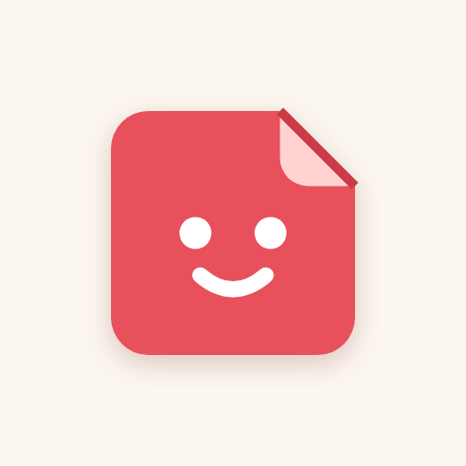

<h1 align="center">Peel</h1>

<b>Turn a photo into a sticker with a white die-cut border, right in your browser.</b> Made with GoodNotes in mind, and your photos never leave your device.

  
  
  
  
  

  <a href="docs/README.md"><b>Docs</b></a> ·
  <a href="#install">Install</a> ·
  <a href="#features">Features</a> ·
  <a href="#screenshots">Screenshots</a> ·
  <a href="docs/goodnotes.md">Into GoodNotes</a>

<picture>
  <source media="(prefers-color-scheme: dark)" srcset="docs/images/hero-dark.png">
  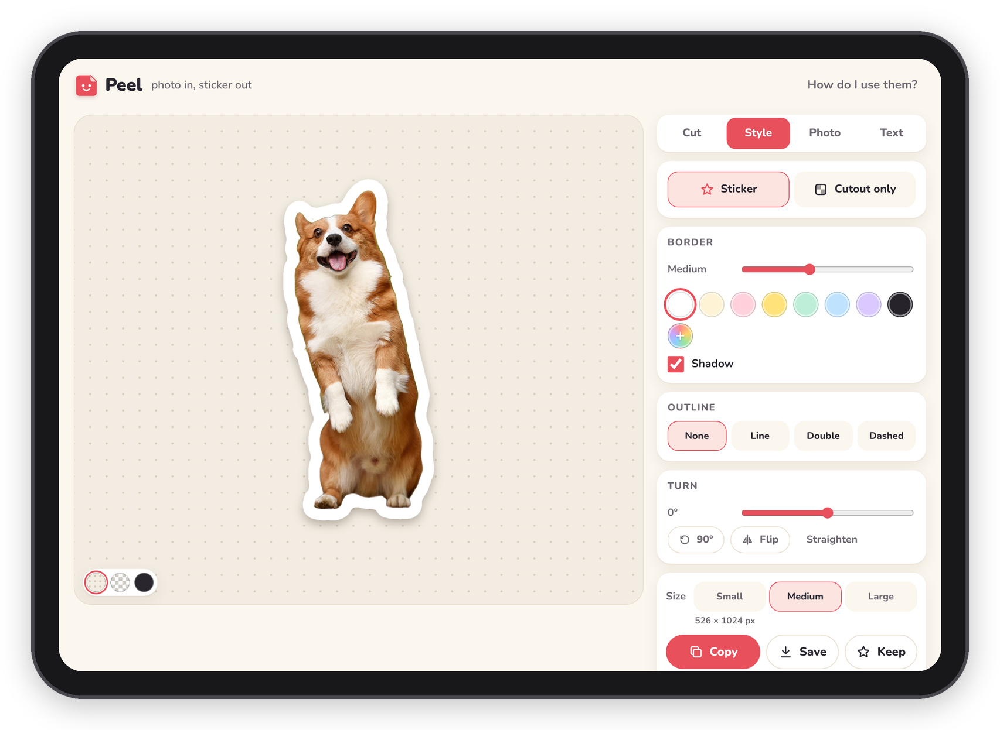
</picture>

## Why I made it

Peel turns a photo into a sticker. You pick a photo, it cuts out the main thing, gives it a white border like a
real die-cut sticker and hands you a PNG with a see-through background, which you can paste straight into
GoodNotes or anywhere else that takes a picture.

I made it with GoodNotes in mind, for anyone who keeps notes, a journal or a planner on an iPad and wants
stickers of their OWN photos: the dog, a plant, a mug, a ticket stub. The free tools I found either want a
subscription before they'll give you a see-through PNG, or let you do one or two and then ask you to pay, and
most of them don't add the white border at all, which is the part that makes it look like a sticker.

Peel is free, there's no account, and everything happens on your own device, which means your photos never get
uploaded anywhere. Basically, instead of a background remover, a photo editor and a sticker app, you only have
one page to open.

## Features

### Making it
- **Cut out.** Pick a photo and Peel finds the main thing in it and cuts it out. Small stray bits next to it
  (a corner of the table, blurry lights in the back) are dropped on their own.
- **Pick the thing.** Drag a box around what you want and it cuts again from just that part, which is how you
  choose one thing out of a busy photo.
- **Several from one photo.** After **Keep**, Peel goes straight back to the box so you can pick the next part.
  When the cutout has separate things in it, **Keep each piece separately** makes one sticker of each in one tap.
- **Circle, Heart, Square.** Photo stickers in a shape, with no cutting involved.
- **Text sticker.** Words on their own, in six fonts, with the border wrapping around the letters.
- **Many at once.** **Pick photos** takes several and makes a sticker of each with the style you have set.
- **Paste.** If you lifted something out of a photo on your iPad or iPhone, copy it and paste it in, and Peel
  skips the cutting and just adds the border.
- **Recent photos.** Your last eight photos wait on the start screen, for another sticker from the same photo later.

### Fixing it
- **Erase and Bring back.** Brushes for the bits the cutter got wrong, with pinch to zoom and two fingers to move around.
- **Magic wand.** Tap a colour to take it out, just the patch you touched or everywhere, which is the quickest way
  to clear a plain background or lift a doodle off paper.
- **Remove piece.** Tap a stray bit and it's gone.
- **Edge.** Shrink or grow the edge by a few pixels, and smooth it. Shrinking takes off a halo of the old background.
- **Undo and Redo,** 25 steps.

### Dressing it up
- **Border and shadow.** From none to chunky, in white or any colour.
- **Outline.** A line, a double line or a dashed line around the border, in any colour.
- **Cutout only.** Just the cutout on a see-through background, with no border, outline or shadow.
- **Turn and flip,** and a preview on paper, on a see-through checkerboard or on dark.
- **Photo looks.** Vivid, Pastel, Vintage, B&W, Warm and Cool, plus brightness, contrast and colour.
- **Words on a sticker.** Type something, pick a font and a colour and drag it where you want it.

### Getting it out
- **Copy, Save, Keep.** Copy puts the PNG on the clipboard, ready to paste into GoodNotes. Save opens the share
  sheet on an iPad or phone and downloads on a computer. Every sticker you copy, save or keep lands in "My stickers".
- **Sharp at any size.** Small (512 px), Medium (1024 px) or Large (as big as the photo allows, up to 2400 px).
  The export is made again from the full photo, so a small thing in a big photo still comes out crisp.
- **My stickers.** Tap one to open it again and change it. **Save all** hands over the lot at once.
- **Sticker sheets.** **Make a sheet** lays your stickers out on Letter, A4, an iPad page or a square, as pictures
  or one PDF, to print on sticker paper or to add to GoodNotes as a page.

## Screenshots

<picture>
  <source media="(prefers-color-scheme: dark)" srcset="docs/images/ipads-dark.png">
  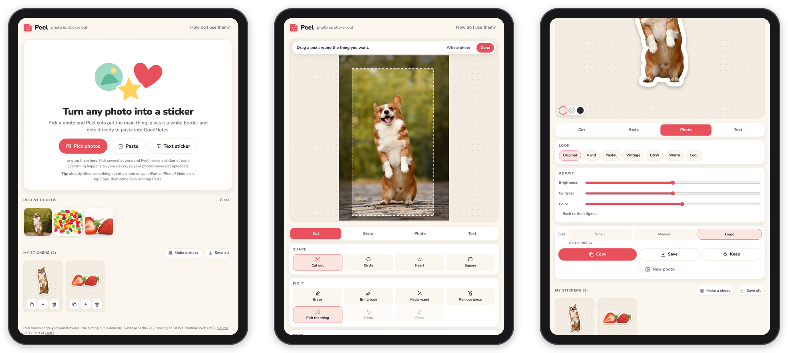
</picture>

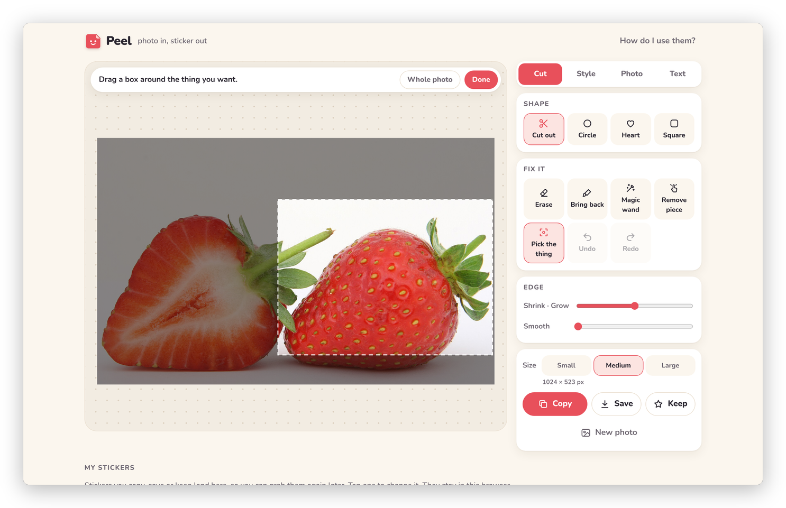
*"Pick the thing": drag a box around the part you want and Peel cuts again from just that.*

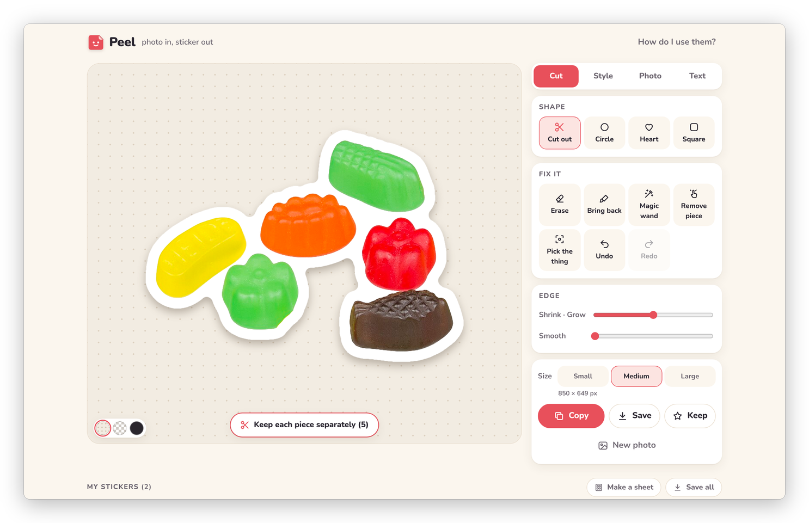
*When the cutout has separate things in it, one tap makes a sticker of each.*

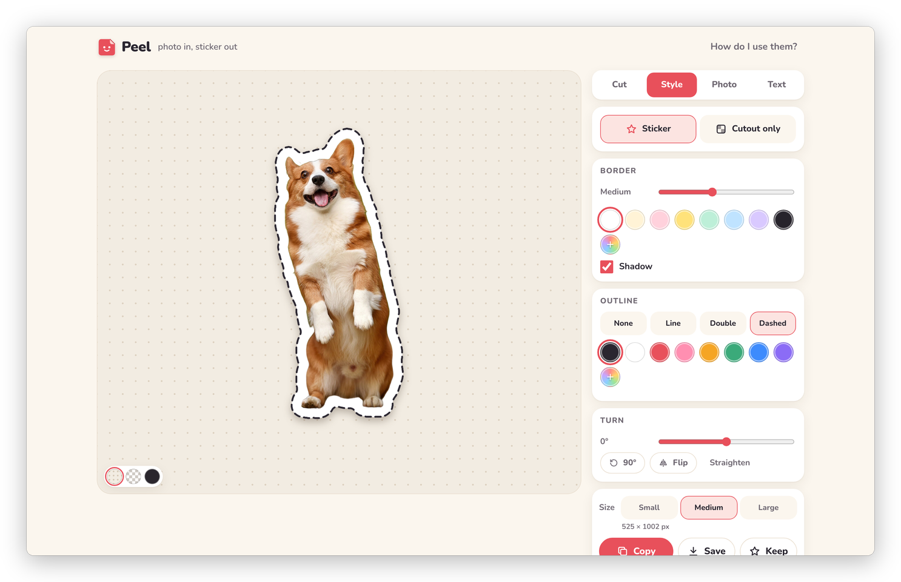
*Border, outline, shadow and turn, all under Style.*

More screenshots

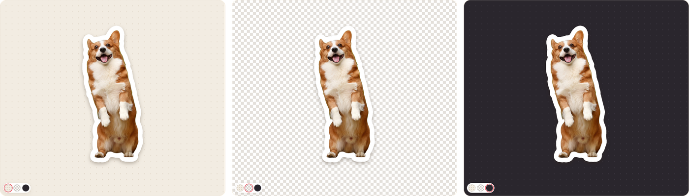
*The preview background: paper, see-through and dark.*

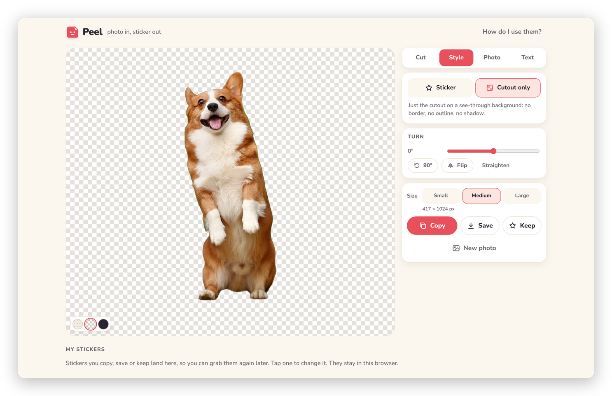
*"Cutout only": just the cutout, no border.*

*Erase and Bring back, zoomed in for the fiddly bits.*

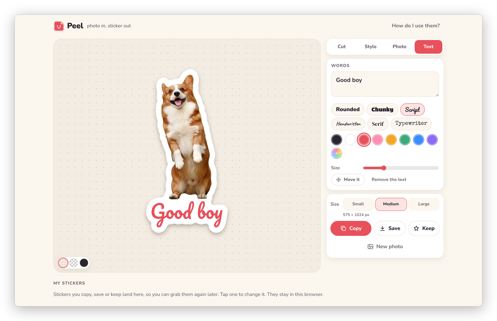
*Words on a sticker, and the border wraps around them.*

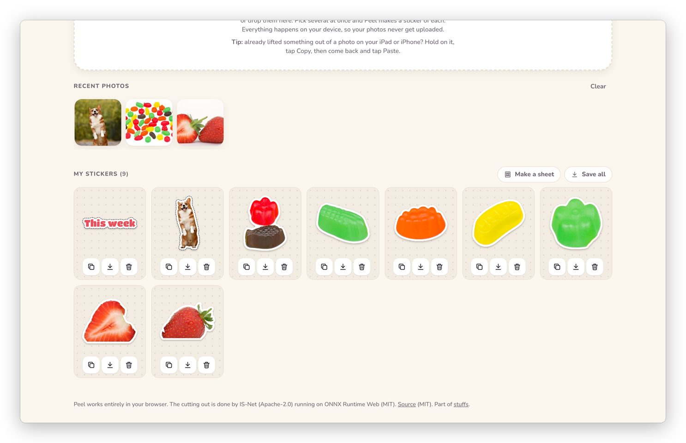
*My stickers, with everything you copied, saved or kept.*

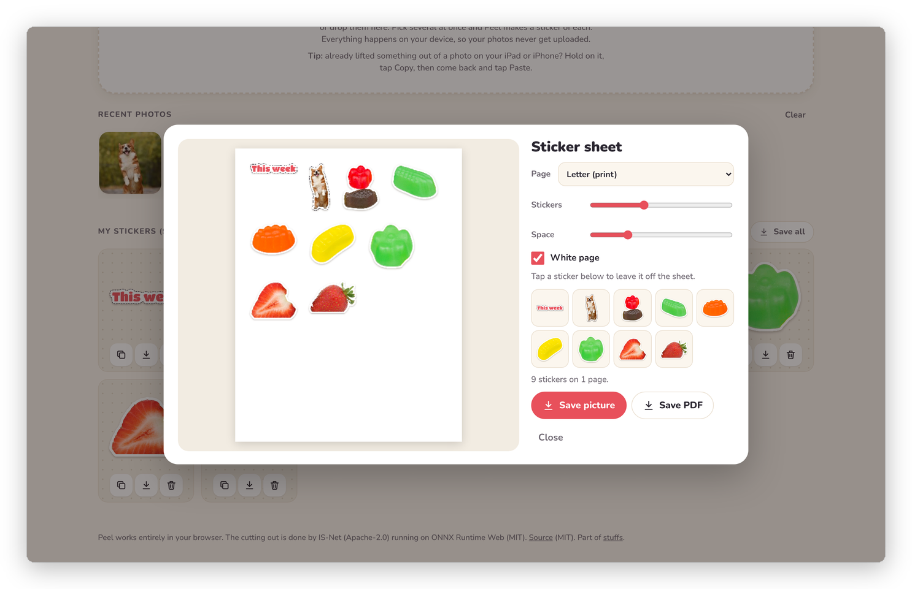
*A sticker sheet, to print or to add to GoodNotes as a page.*

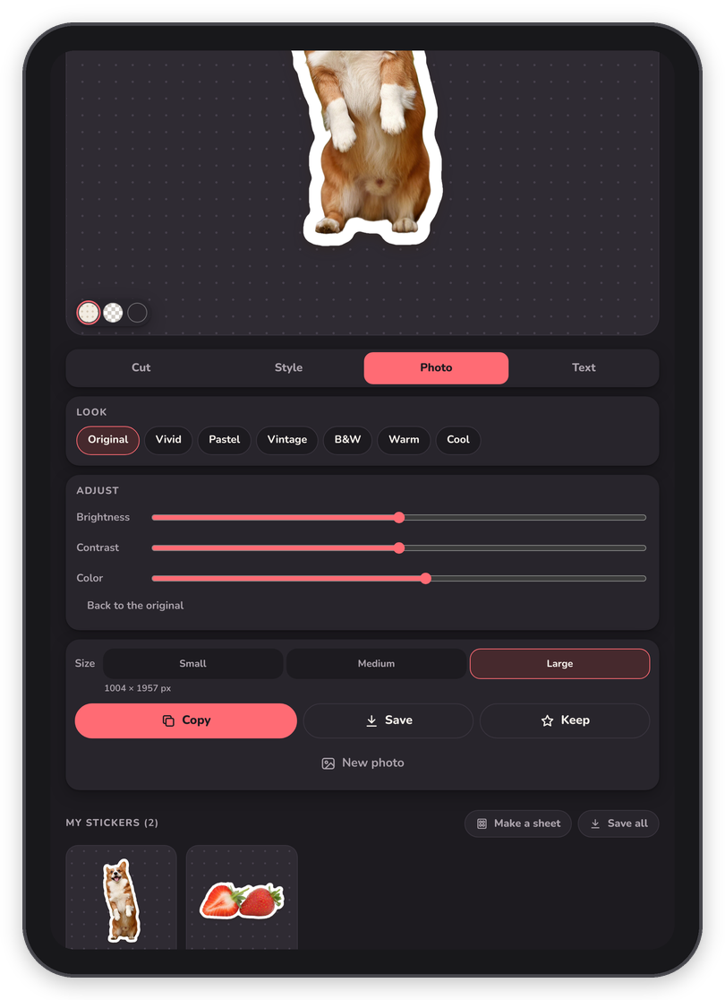
*On an iPad in dark mode: the size, Copy, Save and Keep.*

## Install

### On the web
There's nothing to install. Open Peel in Safari on your iPad (or any up-to-date browser on a phone or computer),
pick a photo and you have a sticker. The link to my copy is in [Install](docs/install.md). The first time you cut
something out, it downloads the cutter (about 90 MB) and the engine that runs it, and after that they're kept in
the browser.

### On your Home Screen
On an iPad or iPhone, tap the Share button in Safari and choose **Add to Home Screen**, and Peel opens like an app
with its own icon. [Install](docs/install.md) has the steps for other browsers too.

### Your own copy
Peel is a folder of plain files with no build step, so any web server can host it. You fetch the cutter once with
`tools/fetch.sh` and send two headers that let it use more than one processor core. [Your own copy](docs/server.md)
has the details.

## Documentation

The docs walk through everything Peel does, in order:

- **Getting started:** [What is Peel?](docs/what-is-peel.md) and [Install](docs/install.md)
- **Using Peel:** [Making a sticker](docs/making-a-sticker.md), [Fixing the cutout](docs/fixing-the-cutout.md),
  [Dressing it up](docs/dressing-it-up.md) and [Getting it out](docs/getting-it-out.md)
- **GoodNotes and other apps:** [Into GoodNotes](docs/goodnotes.md)
- **Running your own copy:** [Your own copy](docs/server.md)
- **Under the hood:** [Developing](docs/DEVELOPING.md)

Start with [What is Peel?](docs/what-is-peel.md)

## How it's built

- Plain HTML, CSS and JavaScript modules in `app/`, with no framework and no build step.
- The cutting out is done by IS-Net (DIS, general use), running in the browser on ONNX Runtime Web, on the
  graphics chip (WebGPU) when the browser has it and on the processor (WebAssembly) otherwise.
- Everything you make stays in your browser: My stickers and recent photos in IndexedDB, the cutter in Cache
  Storage, and your settings in local storage.
- Borders, outlines, the edge tools, the magic wand, sticker sheets (with a small PDF writer) and zips are all
  done in the page with plain canvas code, with no libraries.

## Credits

Peel stands on these, each under its own terms (the same list is in [NOTICE](NOTICE)):

- **IS-Net "isnet-general-use"** weights from [DIS](https://github.com/xuebinqin/DIS) (Xuebin Qin et al.),
  Apache License 2.0, via the ONNX export in [rembg](https://github.com/danielgatis/rembg) (MIT).
  `tools/build_model.py` changes the storage (float16 weights, side outputs dropped, MaxPool ceil_mode off for a
  fixed 1024x1024 input); the computed result is the same.
- **[ONNX Runtime Web](https://github.com/microsoft/onnxruntime) 1.30.0**, MIT License, Copyright (c) Microsoft Corporation.
- **Fonts** in `app/fonts`, each with its licence file next to it: Nunito, Titan One, Pacifico, Caveat and
  DM Serif Display under the SIL Open Font License 1.1, and Special Elite under the Apache License 2.0.

The photos in the screenshots are public domain or CC0, from Wikimedia Commons, credited in
[docs/images/CREDITS.md](docs/images/CREDITS.md).

Peel itself is MIT licensed, see [LICENSE](LICENSE).
