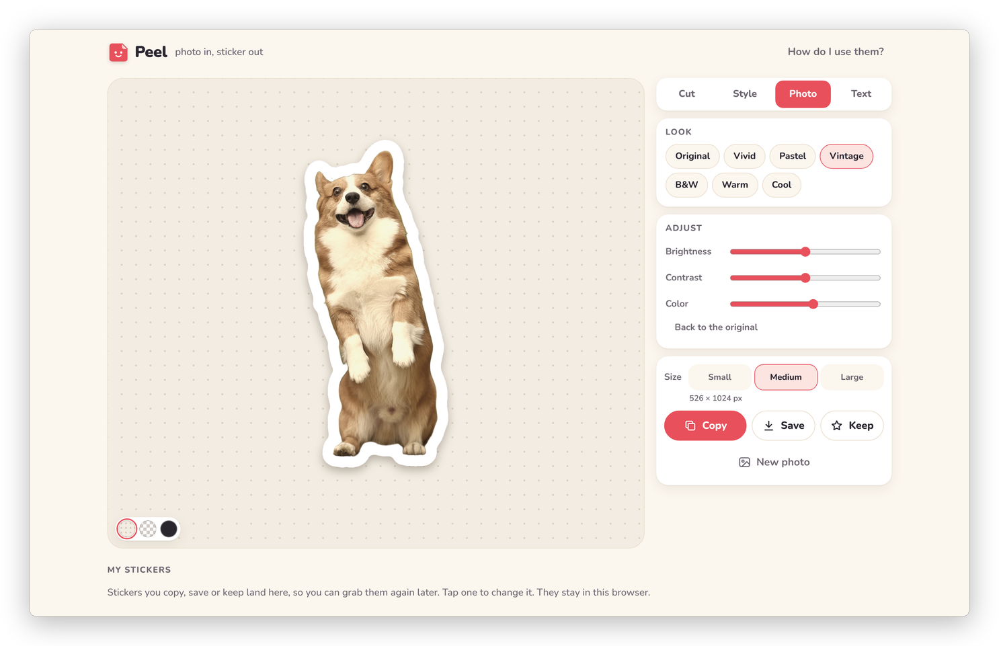

[Peel docs](README.md) › Using Peel

# Dressing it up

This page covers the **Style**, **Photo** and **Text** tabs, which are everything about how the sticker looks:
the border, the outline, the shadow, turning it, the photo's colours and words on it. Peel remembers your style for
the next sticker, so once you've found a look you like, every sticker after it starts that way.

## Sticker or Cutout only

At the top of **Style** there are two choices. **Sticker** is the white-bordered sticker, and **Cutout only** is
just the cutout on a see-through background, with no border, no outline and no shadow, for when you want the thing
on its own. Every sticker comes out as a PNG with a see-through background either way, and choosing **Cutout only**
switches the preview to the checkerboard so you can see what's see-through.

*Cutout only: just the corgi, on a see-through background.*

## Border and shadow

The **Border** slider goes from None through Thin, Medium and Thick to Chunky, and the name next to it says which.
Under it are eight colours, from white and cream to pastels and almost black, and the **+** at the end opens a colour
picker for any other colour. **Shadow** puts a soft shadow under the sticker, which always falls downward, whichever
way you turn it. The shadow is part of the PNG, so turn it off if you'd rather add your own in GoodNotes.

## Outline

**Outline** draws a line around the sticker: **None**, **Line**, **Double** (a second, coloured border just outside
the first) or **Dashed** (a dashed line along the edge of the border, like a cut-here mark). As soon as you choose
one, its colours show up under it, again with a **+** for any colour.

*A dashed outline in the dark ink colour.*

## Turn and flip

The **Turn** slider turns the sticker anywhere from −180° to 180°, and it clicks into place at 0°, 90° and 180° so
straight is easy to find. **90°** turns it a quarter at a time, **Flip** mirrors it, and **Straighten** puts it
back. Turning and flipping are for this sticker only, so the next one starts straight.

## The preview background

The three round buttons at the bottom left of the stage change what's behind the sticker on screen: paper, a
see-through checkerboard, or dark. They're only for looking. The PNG always has a see-through background, whichever
one you pick, and the dark one is handy for checking a white border on a dark page.

*Paper, see-through and dark. The sticker is the same in all three.*

## Photo looks

The **Photo** tab changes the colours of the photo inside the sticker, never the border or the words. **Look** has
one-tap looks: Original, Vivid, Pastel, Vintage, B&W, Warm and Cool. Under **Adjust**, **Brightness**, **Contrast**
and **Color** fine-tune it, on top of the look. **Back to the original** undoes all of it.

*The Vintage look: a little warmer and softer.*

## Words

The **Text** tab puts words on the sticker. Type under **Words** (a new line starts a second line), then pick a font,
a colour and a size. The six fonts are Rounded, Chunky, Script, Handwritten, Serif and Typewriter, and each button
shows its own font. The first words go just under the thing you cut out, and **Move it** lets you drag them anywhere,
even partly outside the photo. **Remove the text** takes them off again.

The words become part of the sticker, which means the border wraps around the letters as well as the photo, the
same way it does on a text sticker.

*Words in Script, and the border goes around them too.*

## Next step

When it looks right, [Getting it out](getting-it-out.md) covers Copy, Save, Keep and the sizes.

Next: [Getting it out](getting-it-out.md) →
