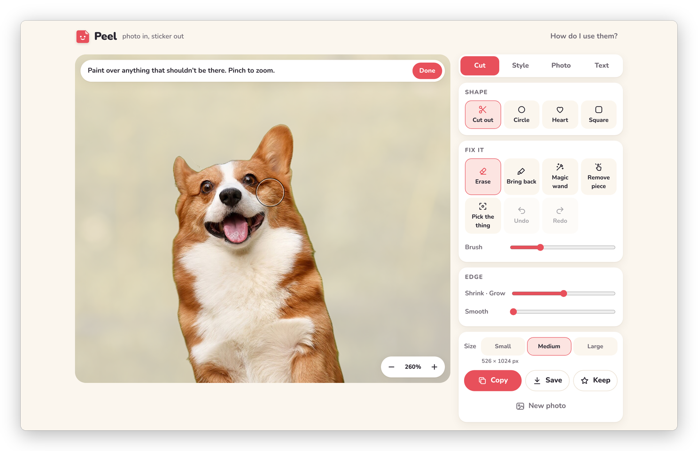
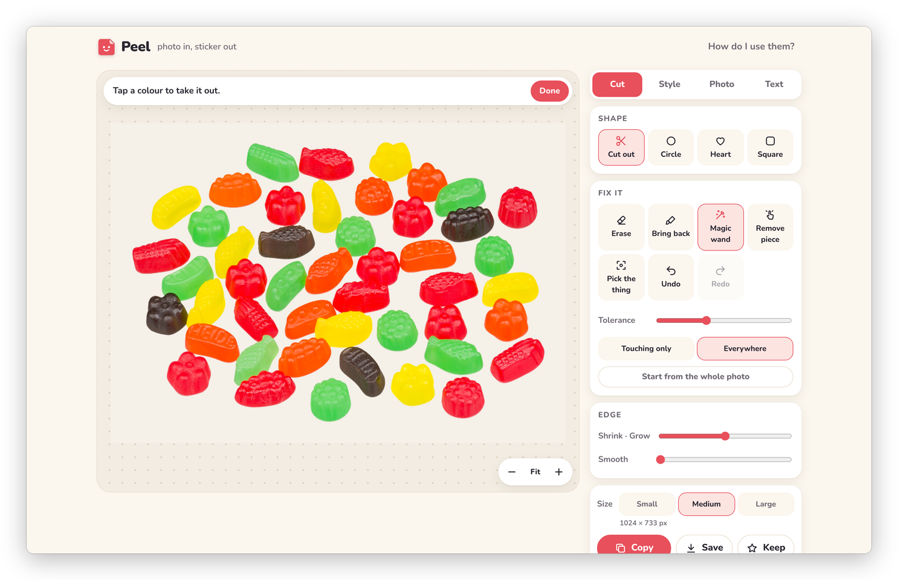

[Peel docs](README.md) › Using Peel

# Fixing the cutout

Fixing a cutout that's almost right is what **Fix it** and **Edge** in the **Cut** tab are for. The cutter gets
most photos right on its own, and when it doesn't, it's usually a bit of background left at the edge or a tail that
went missing, which takes a few seconds with these.

When one of the tools is on, the stage shows the whole photo faded, with the part that's in the sticker bright on
top, so you can see exactly what's in and what's out. A note at the top says what the tool does, and **Done** (or
tapping the tool again) goes back to the sticker.

## Erase and Bring back

**Erase** and **Bring back** are brushes. Paint over anything that shouldn't be there with **Erase**, and over bits
that went missing with **Bring back**. The **Brush** slider sets the size, and the ring on the photo shows it. The
brushes are soft at the rim, so the edge stays smooth.

*Zoomed in on the ears with the Erase brush. The ring is the brush.*

## Zooming in

For the fiddly bits, zoom in. On an iPad or phone, pinch with two fingers, and move around with two fingers. If
you start a stroke and then put a second finger down, Peel takes it as a pinch and drops the stroke, so a zoom never
paints by accident. The **−**, **Fit** and **+** buttons at the bottom of the stage do the same, and the middle one
shows how far in you are.

On a computer, hold ctrl (or ⌘) and scroll, or pinch on the trackpad, to zoom where the pointer is, and scroll to
move around. The **+** and **−** keys zoom too.

## Magic wand

**Magic wand** takes out a colour you tap, which is the quickest way to clear a plain background. **Tolerance** sets
how close a colour has to be to go too. **Touching only** takes the patch of that colour you tapped, and
**Everywhere** takes it from the whole photo, like the gaps between the arms of a chair. If nothing goes, Peel says
"Nothing to take there. Try a bit more tolerance."

**Start from the whole photo** puts the whole photo back in the sticker first. Together with the wand, that's the
way to lift a doodle, a stamp or lettering off paper: start from the whole photo, then tap the paper with
**Everywhere** and only the drawing is left.

*Start from the whole photo, then tap the white with Everywhere: only the sweets are left.*

## Remove piece

**Remove piece** deletes a whole stray bit in one tap, like a leaf that came along with a flower or a crumb next to
a cake. Tap right on it (or close to it) and it's gone, soft edge and all. If there's nothing there, Peel says "Tap
right on the bit you want gone."

## Edge

**Shrink · Grow** moves the whole edge in or out by up to six pixels. Shrinking by one or two is the fix for a thin
halo of the old background around the edge, and growing is for an edge that cut in a little too far. **Smooth**
rounds off a jagged edge. Both work on the cutout before the border goes around it, so the border follows.

## Undo and Redo

**Undo** and **Redo** go back and forward through the last 25 changes to the cutout: brush strokes, the wand,
Remove piece, a new box and a change of shape. On a computer, ⌘Z (Ctrl+Z) undoes, and ⇧⌘Z or ⌘Y redoes. Esc closes
the tool you're in.

If you erase everything, the stage says "Nothing left. Undo, or Bring back." and both of those work.

## Next step

Once the cutout is right, [Dressing it up](dressing-it-up.md) is about the border, the outline and the rest.

Next: [Dressing it up](dressing-it-up.md) →
