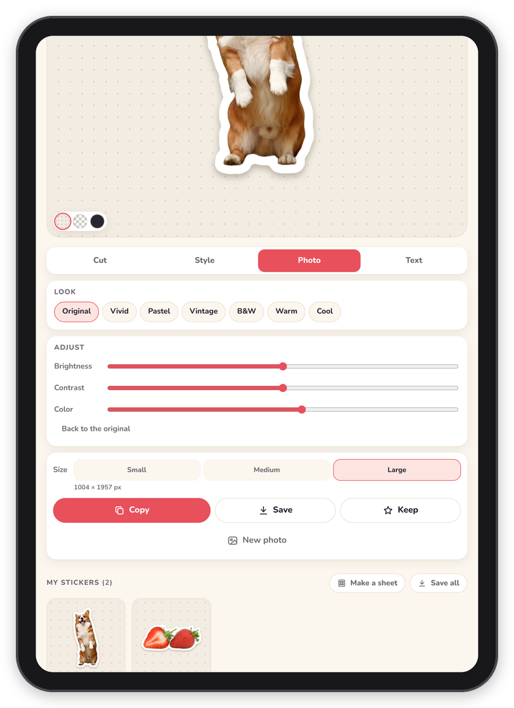

[Peel docs](README.md) › Using Peel

# Getting it out

This page is about the box under the tabs, with **Size**, **Copy**, **Save** and **Keep**, and about "My stickers"
further down the page, where everything you make is kept. Every sticker comes out as a PNG with a see-through
background, which is what GoodNotes and most other apps want.

## The size

**Size** has three choices, and the exact size of the PNG shows under them:

- **Small**, 512 pixels on the long side, for little stickers in the margin.
- **Medium**, 1024 pixels, which is plenty for most pages.
- **Large**, as big as the photo allows, up to 2400 pixels, for a sticker that fills a page or gets printed.

While you work, Peel cuts and fixes on a copy of the photo up to 1200 pixels, which keeps it quick on an iPad. When
you copy, save or keep a sticker, it's made again from the photo itself (up to 2400 pixels), around the sticker
only, with everything you did to it. So a small thing in a big photo still comes out sharp, and Large really is large.

*Large, with the size in pixels under it, and Copy, Save and Keep.*

## Copy, Save and Keep

- **Copy** puts the PNG on the clipboard, and Peel says "Copied! Now paste it into GoodNotes." On a computer, ⌘C or
  Ctrl+C does the same.
- **Save** opens the share sheet on an iPad or phone, where **Save Image** puts it in Photos and **Save to Files**
  puts it in Files. On a computer it downloads the PNG, named after the photo.
- **Keep** puts it in My stickers without copying or saving it, and goes back to the box so you can pick the next
  part of the same photo (see [Several stickers from one photo](making-a-sticker.md#several-stickers-from-one-photo)).

Copy and Save keep the sticker in My stickers too, so you never lose one you made.

## My stickers

"My stickers" is below the editor, and on the start screen. Each sticker has three small buttons: Copy, Save and
Delete. Tap the sticker itself and it opens again in the editor, exactly as you left it, with the cutout, the style,
the look and the words, so you can change something and keep it again. Peel says "Opened it again. Keep saves a new
copy.", which means the old one stays as it was.

*Recent photos on top, and My stickers under them.*

One thing to know: a sticker you open again from My stickers keeps the working copy of the photo (up to 1200
pixels), not the full photo. So if you want the sharpest Large of something, make it from the photo, which is easy
with "Recent photos" on the start screen.

## Save all

**Save all** shows up once there are two or more stickers. On an iPad or phone it opens the share sheet with all of
them, where **Save Images** puts them all in Photos at once. On a computer it downloads one zip with every sticker
in it, numbered.

## Sticker sheets

**Make a sheet** lays your stickers out on pages, to print on sticker paper or to add to GoodNotes as a page of its
own. **Page** is Letter or A4 (for printing), an iPad page, or a square. **Stickers** sets how big they are on the
page, **Space** how far apart, and **White page** puts them on white instead of see-through. Tap a sticker in the row
under the settings to leave it off the sheet, and tap it again to put it back. When there are more than fit, Peel
starts a second page.

**Save picture** saves each page as a PNG, and **Save PDF** saves all the pages as one PDF, always on white, which is
what a printer wants.

*Nine stickers on a Letter page, ready to print.*

## Next step

The stickers are ready. [Into GoodNotes](goodnotes.md) is about where they go next.

Next: [Into GoodNotes](goodnotes.md) →
