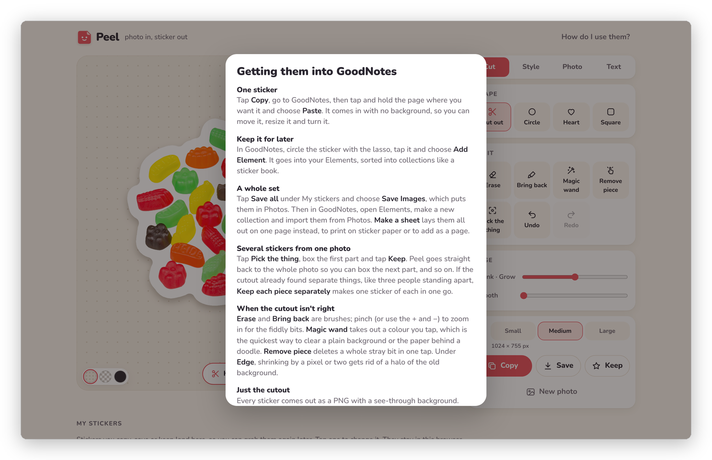

[Peel docs](README.md) › GoodNotes and other apps

# Into GoodNotes

Regarding getting the stickers into GoodNotes, this page has the three ways I know of: pasting one sticker onto a
page, keeping it in GoodNotes' Elements to use again, and bringing in a whole set at once. The same steps are in
Peel itself, under **How do I use them?** at the top right.

One honest note first: I put the GoodNotes steps together from guides on the web, and I haven't tried each one
myself, and GoodNotes changes its menus now and then. If a button has a different name on your iPad, go with what
you see, and feel free to open an issue so I can fix the page.

*The same steps, in Peel's own help.*

## One sticker

1. In Peel, tap **Copy**.
2. Go to GoodNotes, then tap and hold the page where you want the sticker.
3. Choose **Paste**.

It comes in with no background, as a picture you can move, resize and turn like any other. If Copy doesn't work in
your browser, tap **Save**, choose **Save Image**, and add it from Photos in GoodNotes instead.

## Keep it for later

In GoodNotes, circle the sticker with the lasso, tap it and choose **Add Element**. It goes into your Elements,
where you can sort stickers into collections like a sticker book, and from then on it's one tap away in any notebook.

## A whole set

1. In Peel, tap **Save all** under My stickers and choose **Save Images**, which puts them all in Photos.
2. In GoodNotes, open Elements and make a new collection.
3. Import them from Photos.

Or tap **Make a sheet** in Peel instead, which lays them all out on one page. Save it as a PDF or a picture, and
you can print it on sticker paper or add it to a notebook as a page. [Getting it out](getting-it-out.md#sticker-sheets)
has the details.

## Other apps

The stickers are ordinary PNG pictures with a see-through background, so they work anywhere that takes a picture:
Notability, Freeform, Procreate, Messages, Canva and the rest. Copy and paste is usually the quickest, and Save is
there for everything else.

Basically, instead of a sticker pack someone else made, you have stickers of YOUR things, in whatever app you write in.

## Next step

That's the whole tour. If you'd like to run your own copy of Peel, [Your own copy](server.md) is next.

Next: [Your own copy](server.md) →
