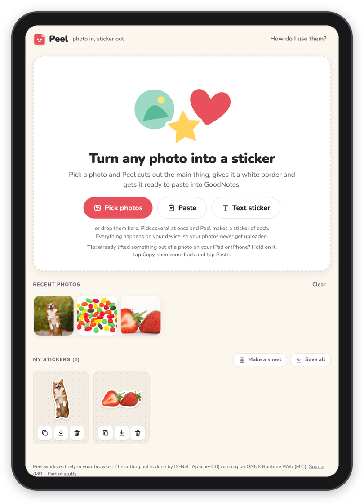

[Peel docs](README.md) › Getting started

# Install

Installing Peel is the easy part, because there's nothing to install: it's a web page, and you open it in the
browser you already have. My own copy is at **https://stuffs.tiresia.xyz/stickers/**, and anyone can use it.
If you'd rather run one of your own, [Your own copy](server.md) explains how.

## Open it

On an iPad or iPhone, open the address in Safari. On an Android phone or tablet, Chrome is fine, and on a computer
any up-to-date browser works. You'll land on "Turn any photo into a sticker", with three buttons: **Pick photos**,
**Paste** and **Text sticker**.

*The start screen, with the last few photos under "Recent photos".*

## The first time

The first time you cut something out, Peel downloads the cutter, about 90 MB, plus the engine that runs it, about
28 MB. While it does, the photo shows faintly behind a note that says "Getting the scissors ready" with how many MB
are done, and "This only happens the first time." Then it says "Cutting it out…" for a few seconds and the sticker
appears. It starts the download as soon as you tap **Pick photos**, so it's already going while you choose a photo.

After that the cutter is saved in the browser, which means the next time it only needs a moment to start, and it
gets ready quietly in the background as soon as you open the page. If you can, do the first one on Wi-Fi.

If the cutter can't run in your browser at all, Peel says "The cutter couldn't run in this browser." and switches
to a square photo sticker after a few seconds. The shapes (Circle, Heart, Square), text stickers and pasted
pictures that are already cut out all work without it.

## On your Home Screen

On an iPad or iPhone, Peel can sit on the Home Screen with its own icon and open full screen, like an app:

1. Open Peel in Safari.
2. Tap the **Share** button (the square with the arrow).
3. Choose **Add to Home Screen**, then **Add**.

One thing to know: on an iPad or iPhone, the Home Screen copy keeps its own storage, separate from Safari's. So
My stickers from Safari won't show up in the Home Screen copy (and the cutter downloads once more there). Pick one
and stick with it, which means all your stickers are in one place.

On Android, the browser menu has **Add to Home screen** (or **Install app**). On a computer, some browsers offer to
install it as an app, and otherwise a bookmark does the same job.

## What it needs

- A recent browser. The cutter needs WebAssembly, which every current browser has, and uses WebGPU when it's there.
- Room for the cutter, about 120 MB in all the first time.
- For **Copy**, a browser that lets a page put a picture on the clipboard. If yours won't, Peel says so and
  **Save** does the job instead.

## Next step

Now that it's open, [Making a sticker](making-a-sticker.md) walks through your first one.

Next: [Making a sticker](making-a-sticker.md) →
