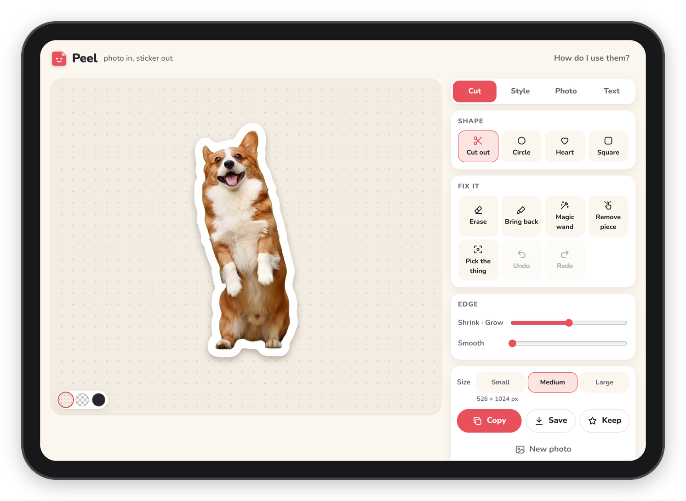
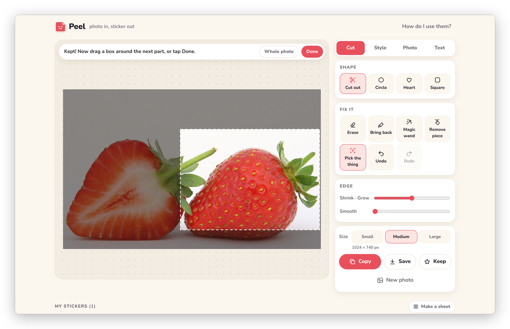
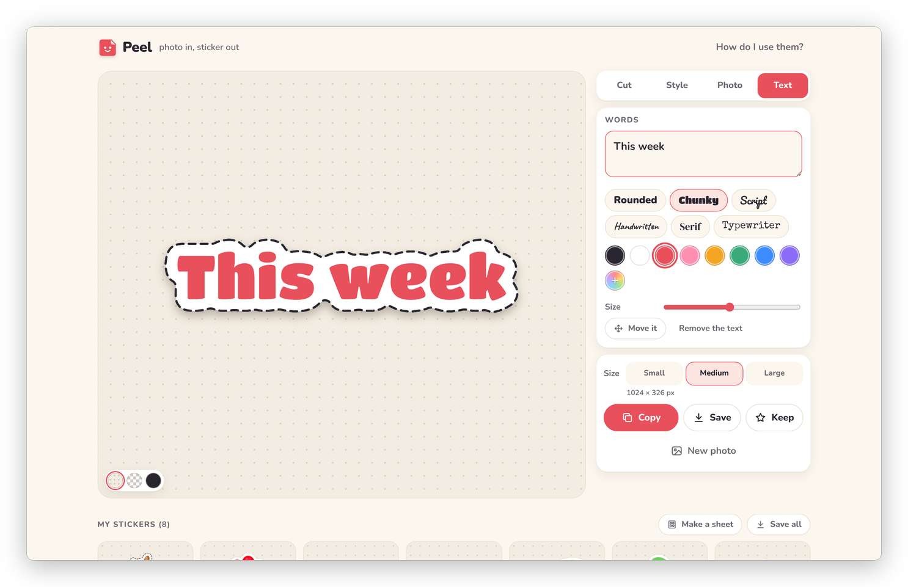

[Peel docs](README.md) › Using Peel

# Making a sticker

This page is about getting from a photo to a sticker: the ways to start, how to pick one thing out of a busy photo,
and how to make several stickers from one photo. Fixing the edge and dressing the sticker up have their own pages.

## From a photo

Tap **Pick photos** on the start screen and choose a photo. Peel says "Cutting it out…", and a few seconds later
the main thing is on the stage with a white border around it. Small stray bits that come along with it, like a
corner of the table or blurry lights in the background, are dropped on their own, as long as they're small next to
the main thing.

You can also drop photos onto the page on a computer, or use **Paste** (see below). Once you're in the editor,
**New photo** under the buttons opens the picker again.

*Pick a photo and the main thing comes out with a border. The Cut tab is on the right.*

If Peel can't find one clear thing in the photo, it says so and suggests **Pick the thing** or a shape, which is
usually the answer.

## Pick the thing

When the photo has more than one thing in it, or Peel picked the wrong one, open the **Cut** tab and tap **Pick the
thing**. The whole photo comes back, and a note at the top says "Drag a box around the thing you want." Drag a box
around it and let go, and Peel cuts again from just that part.

*Drag a box around the part you want. Outside the box goes dark.*

**Whole photo** in the note goes back to using the whole photo, and **Done** closes the box view without changing
anything. Leave a little room around the thing, because whatever is outside the box is left out of the sticker.

## Several stickers from one photo

This is how you get a whole set out of one photo. Box the first thing and tap **Keep**. Peel keeps that sticker in
My stickers and goes straight back to the box view, with "Kept! Now drag a box around the next part, or tap Done."
Box the next thing, tap **Keep** again, and so on.

*After Keep, Peel is ready for the next part of the same photo.*

When the cutout already has separate things in it, like a few sweets on a table or three people standing apart, a
button appears at the bottom of the stage: **Keep each piece separately**, with how many pieces it found. One tap
makes one sticker of each, and the biggest one comes first in My stickers. Things that touch count as one piece,
and tiny specks don't count at all. The button doesn't show for shapes, or once there are words on the sticker.

*Two of the six sweets touch, so they make one piece, and the button says 5.*

## Shapes

Under **Shape** in the Cut tab, **Circle**, **Heart** and **Square** make a photo sticker in that shape instead of
cutting anything out. In a shape, the button under **Fix it** says **Move it**, and the box you drag picks the part of
the photo that goes inside the shape. **Cut out** takes you back to the cutout.

## Text stickers

**Text sticker** on the start screen makes a sticker of words on their own, with the border wrapping around the
letters, which is nice for headings in a planner. Type under **Text**, and the font, colour and size are there too.
The border and outline are under **Style**, the same as for a photo. [Dressing it up](dressing-it-up.md) has the rest.

*A text sticker, with a dashed outline.*

## Paste

If you've already lifted something out of a photo on your iPad or iPhone (touch and hold it in Photos and choose
**Copy**), come back to Peel and tap **Paste**. A picture that already has a see-through background skips the cutting
completely, which means Peel just adds the border and keeps the edge you lifted. An ordinary photo on the clipboard
gets cut out like any other. If the browser won't let the button read the clipboard, Peel tells you to tap and hold
and choose Paste instead (or press ⌘V or Ctrl+V on a computer).

## Many photos at once

Pick several photos at once (or drop several) and Peel makes a sticker of each, one after the other, with the style
and size you have set. A bar at the bottom says "Making sticker 2 of 6…", and **Stop** stops after the one it's on.
They all go into My stickers, and you can tap any of them to touch it up.

## Recent photos

The last eight photos you opened wait on the start screen under "Recent photos". Tap one to open it again, which is
handy when you want another sticker from the same photo later. **Clear** empties the row.

## Next step

If the cutout needs a little help, [Fixing the cutout](fixing-the-cutout.md) is next.

Next: [Fixing the cutout](fixing-the-cutout.md) →
